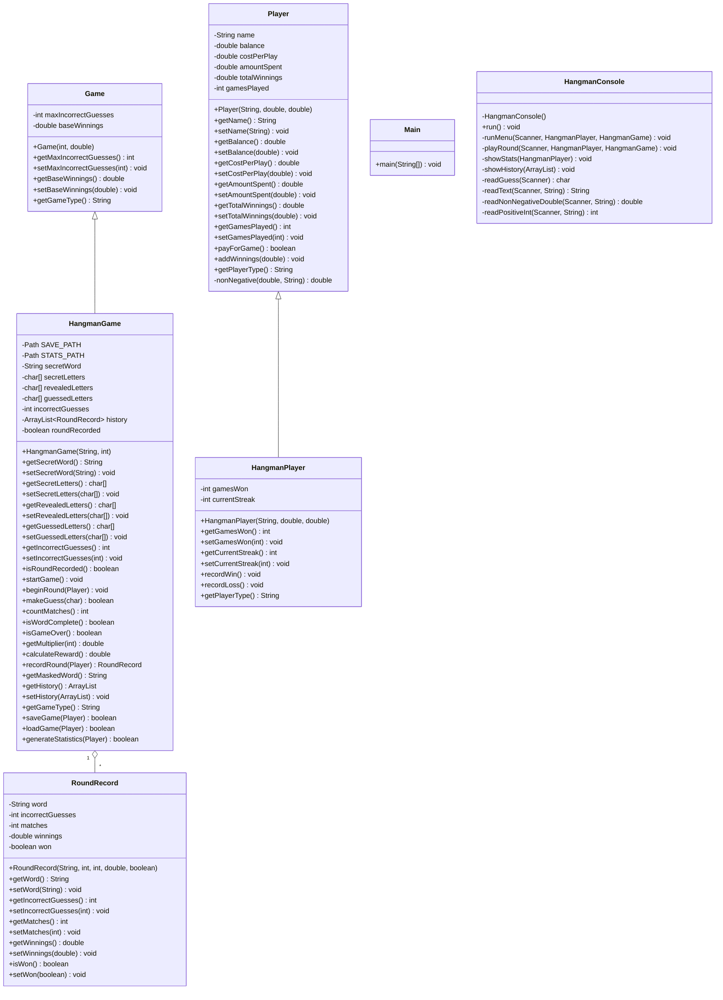

# Hangman – Practical Exam 2

AI assistance: ChatGPT helped resolve merge conflicts, update code, and prepare these notes after instructor approval. Students should review the changes, add their own edit notes, and record each partner's actual contribution.

## Algorithm

1. Ask for player and game settings. Re-prompt for invalid numbers or blank text.
2. Keep the secret word and revealed characters in arrays of equal length. Show punctuation and spaces immediately.
3. Before each round, check the wallet and deduct the entry fee only if it is affordable.
4. Read one letter. Reject invalid or repeated guesses. Compare the guess to each secret array position, reveal all matching positions, or count a wrong guess.
5. End when all letters are revealed or the wrong-guess limit is reached. Count revealed letter positions and apply the matching prize multiplier.
6. Add a RoundRecord, credit winnings, update player totals, and show the result.
7. The menu displays stats/history, saves or reloads state, and writes a statistics report. File errors are shown without terminating the menu.

Multiplier tiers: 0-1 matches = 1.0; 2 = 1.2; 3 = 1.5; 4 = 2.0; 5 = 2.5; 6+ = 3.0. Matches are revealed character positions, so repeated letters count once for each position.

## UML

## Tests run

Compile command: `javac -Xdiags:verbose -d <temporary-folder> HangmanGame.java Player.java HangmanPlayer.java RoundRecord.java main.java`. Launch: `java -cp <temporary-folder> Main`. Compile and launch both exited with code 0.

| Case | Observed result |
|---|---|
| Win: solve cat with base prize 10 and entry fee 5 | 3 matches selected ×1.5; winnings 15; starting balance 100 became 110. |
| Loss: one wrong guess at limit 1 | No winnings; entry fee deducted; history recorded loss. |
| Numeric guess | Rejected with a clear message; next guess accepted. |
| Repeated guess | Rejected without changing the revealed positions or wrong-guess count. |
| Insufficient funds | Balance 2 could not pay cost 5; spending and games played stayed at 0. |
| Invalid startup number | Invalid text was rejected and the program prompted again. |
| Save then load in a new process | Balance, player totals, game word, and history restored. |
| Missing save file | Friendly error shown; menu remained usable. |
| Statistics after one win and one loss | File reported 2 games, 1 win, 10 spent, 15 won, net 5, and 50% win rate. |

These were console checks; no screenshots were captured. Capture 8-10 screenshots for submission and attach them to the test cases.

## Complete before submission

- Complete and sign the pledge in Main's file header.
- Add both partners' names, actual work split, and signatures to the collaboration agreement; do not infer contributions.
- Document student changes made after AI assistance.
- Capture and submit 8-10 screenshots. Prepare the Day 6 presentation with both partners explaining their work.
